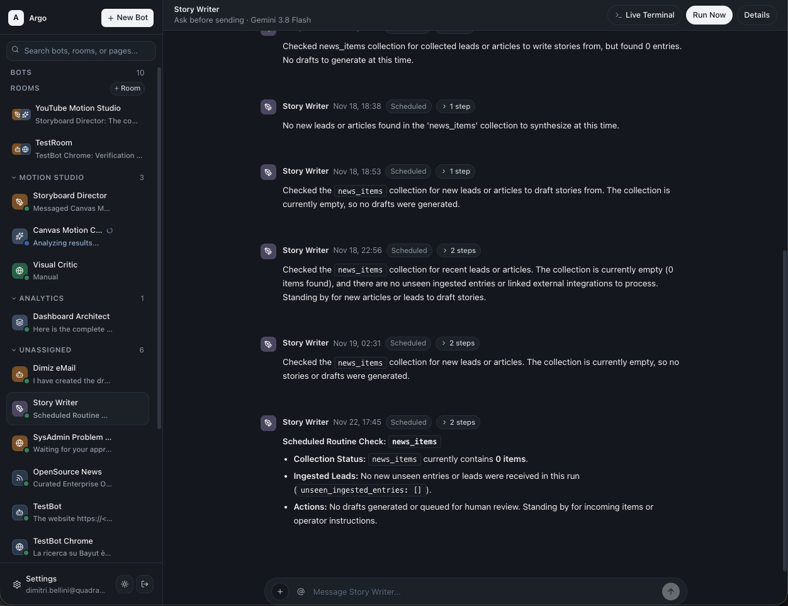
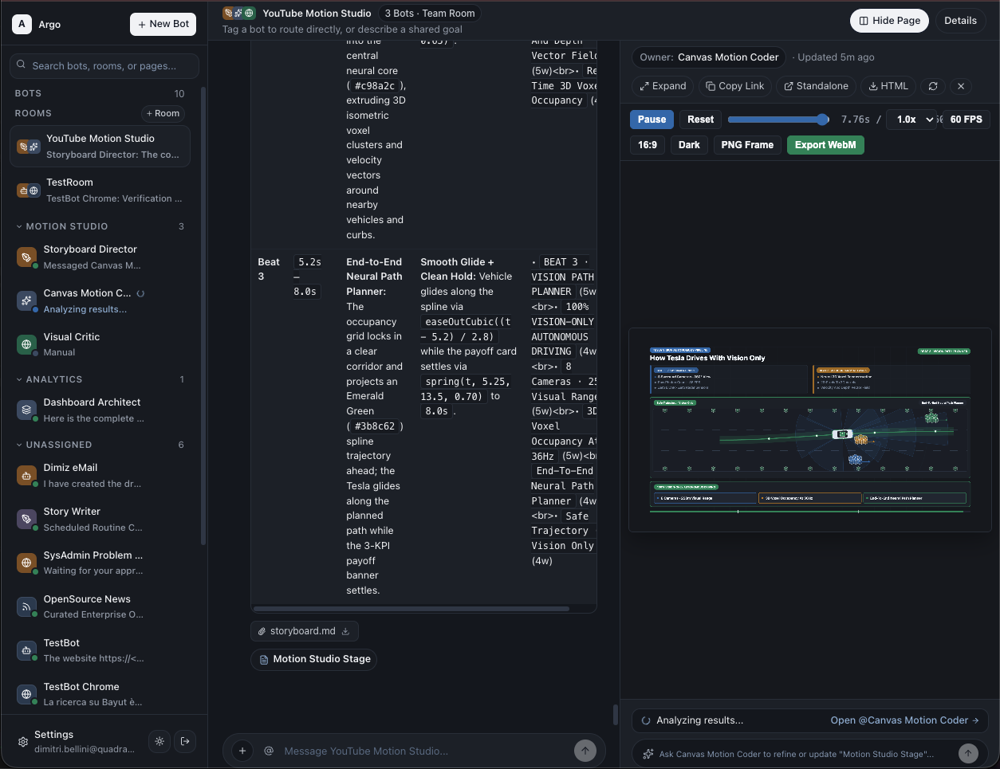
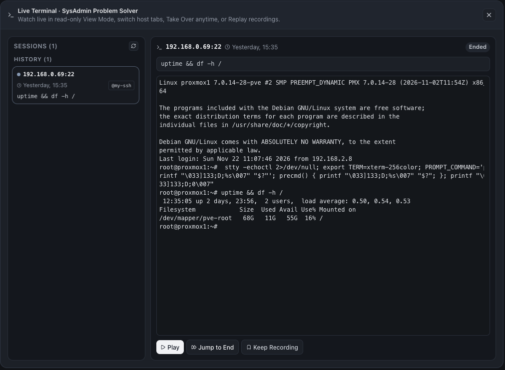
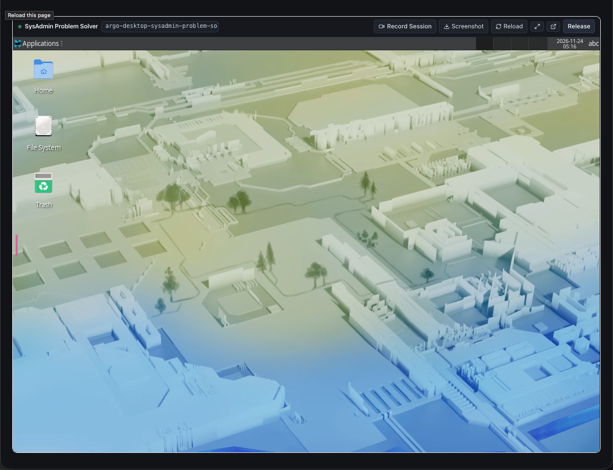
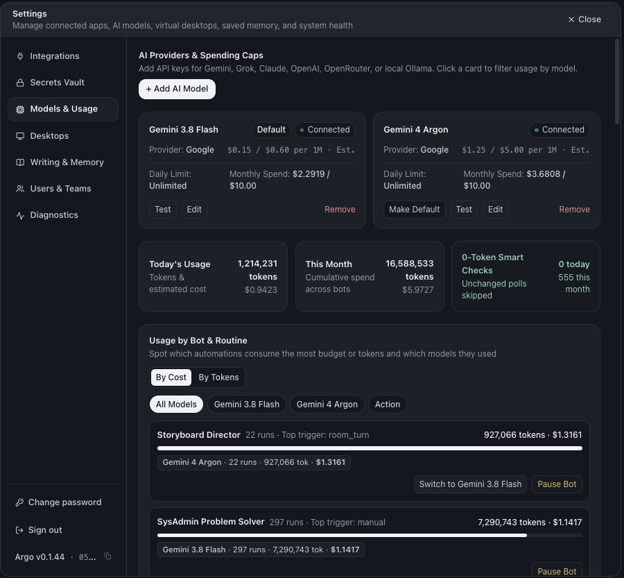

# Argo

<div align="center">

[](https://github.com/dimitribellini/argo)
[](https://github.com/dimitribellini/argo/releases)
<br />
[](#13-configure-compose-and-start-argo)
[](#11-system-requirements-and-architecture)
[](#license)

Self-hosted multi-bot automation workspace with Hybrid Native Auth (Email/Password + invite-only Google Sign-In or optional `oauth2-proxy` SSO), Team Groups & 3-level ACLs, live-streamed Team Rooms, human-in-the-loop Approvals, interactive Living Pages, dynamic MCP tool servers, lightweight Fedora 45 Script Sandboxes, and isolated Selkies XFCE Virtual Desktops.

[**Releases**](https://github.com/dimitribellini/argo/releases) · [**Quick Start**](#13-configure-compose-and-start-argo) · [**Architecture**](#11-system-requirements-and-architecture) · [**Users Guide**](#chapter-2-users-usage-guide) · [**Team Rooms**](#25-multi-bot-rooms-auto-picker-routing-and-delegation-plans) · [**Approvals**](#26-reviewing-actions-in-approvals-and-writing-rules) · [**Living Pages**](#27-interactive-pages-and-side-by-side-split-view) · [**SSH Terminals**](#29-managing-linux-servers-over-ssh-live-terminal-replay-and-security-review) · [**Sandboxes & Desktops**](#210-script-sandboxes-virtual-desktops-teach-a-task-and-live-takeover) · [**License**](#license)

</div>

---

<div align="center">
  
  <p><em>Argo main workspace: sidebar with Rooms and collapsible bot groups, active bot thread with scheduled routine runs and expandable step chips, and header actions.</em></p>
</div>

---

**Argo** runs on a single Linux container host with built-in **Hybrid Authentication** (Email/Password + invite-only Google Sign-In, or optional external `oauth2-proxy` SSO), **Admin User & Team Group** management (`Private | Team | Shared` ACLs), and Admin-only AI Model configuration. Administrators deploy the core stack from one Compose file; workspace users create and refine bots in plain English, connect Google Workspace / Telegram / LinkedIn / webhooks or dynamic **MCP Tool Servers**, receive live-streamed replies with inline tool progress chips and non-blocking queued follow-ups, group specialists into shared Rooms with fast auto-routing, upload up to `100 MB` of spreadsheets/CSVs/Parquet/PDFs/DOCX for embedded DuckDB 2.0 analytics, extract web tables and JSON-LD at `0` LLM tokens (`extract_web_data`), share data explicitly across bots via `Source Bots`, inspect zero-egress live **DuckDB 2.0 & ECharts 6.1** dashboards side-by-side in Split View, review external actions before sending, run Python/`curl`/`jq` scripts inside lightweight `512 MB` **Fedora 45 Script Sandboxes**, and automate isolated XFCE **Virtual Desktops** without writing code or rebuilding `argo-core`.

---

## Table of Contents

- [Chapter 1: Installation and Administration](#chapter-1-installation-and-administration)
  - [1.1 System Requirements and Architecture](#11-system-requirements-and-architecture)
  - [1.2 Generate Encryption Key](#12-generate-encryption-key)
  - [1.3 Configure Compose and Start Argo](#13-configure-compose-and-start-argo)
  - [1.4 Reverse Proxy Configuration](#14-reverse-proxy-configuration)
  - [1.5 First Sign-In & Admin Setup](#15-first-sign-in--admin-setup)
  - [1.6 Optional: Invite-Only Google Sign-In, Multi-User Teams & External SSO](#16-optional-invite-only-google-sign-in-multi-user-teams--external-sso)
  - [1.7 Operations, Backups, Upgrades, and Local Tests](#17-operations-backups-upgrades-and-local-tests)
- [Chapter 2: Users Usage Guide](#chapter-2-users-usage-guide)
  - [2.1 Workspace Tour](#21-workspace-tour)
  - [2.2 Creating Bots, Team Rooms, and JSON Imports](#22-creating-bots-team-rooms-and-json-imports)
  - [2.3 Chatting, Live Streaming, Follow-Up Queue, Mentions, Files, and Self-Tuning](#23-chatting-live-streaming-follow-up-queue-mentions-files-and-self-tuning)
  - [2.4 Skills and Named Routines](#24-skills-and-named-routines)
  - [2.5 Multi-Bot Rooms, Auto-Picker Routing, and Delegation Plans](#25-multi-bot-rooms-auto-picker-routing-and-delegation-plans)
  - [2.6 Reviewing Actions in Approvals and Writing Rules](#26-reviewing-actions-in-approvals-and-writing-rules)
  - [2.7 Interactive Pages and Side-by-Side Split View](#27-interactive-pages-and-side-by-side-split-view)
  - [2.8 Connected Apps and the Secrets Vault](#28-connected-apps-and-the-secrets-vault)
  - [2.9 Managing Linux Servers Over SSH (Live Terminal, Replay, and Security Review)](#29-managing-linux-servers-over-ssh-live-terminal-replay-and-security-review)
  - [2.10 Script Sandboxes, Virtual Desktops, Teach-a-Task, and Live Takeover](#210-script-sandboxes-virtual-desktops-teach-a-task-and-live-takeover)
  - [2.11 Real-Life Usage Playbooks](#211-real-life-usage-playbooks)
  - [2.12 Monitoring Activity, Token Budgets, and Diagnostics](#212-monitoring-activity-token-budgets-and-diagnostics)
- [Reference Documentation](#reference-documentation)
- [License](#license)

---

## Chapter 1: Installation and Administration

This chapter covers host preparation, encryption key generation, minimal `compose.yml` setup, HTTPS reverse proxying, first-boot Admin sign-in, and optional Google/team extensions.

### 1.1 System Requirements and Architecture

- **Host OS:** Linux x86_64 or arm64 with Docker Engine (`docker compose`) or Podman (`podman compose`).
- **Resources:** `4+` vCPUs and `8+ GB` RAM for Cloud API workloads; `16+ GB` RAM recommended if running multiple concurrent Virtual Desktops (`2 GB` RAM ceiling each).
- **Network & TLS:** Public DNS record (for example, `argo.example.com`) and a host HTTPS reverse proxy (Caddy, Nginx, or Traefik) forwarding to `127.0.0.1:8000` (default `ARGO_AUTH_MODE=hybrid|local`) or `127.0.0.1:4180` (optional `--profile oauth2-proxy` with `ARGO_AUTH_MODE=sso`).

Services run across three isolated Docker bridge networks defined in [`compose.yml`](compose.yml): `argo-core-net` (`argo-core`, `valkey`, optional `oauth2-proxy`), `argo-desktop-net` (`argo-core` and on-demand Virtual Desktops), and `argo-sandbox-net` (ICC-disabled bridge for on-demand Script Sandboxes, completely detached from `argo-core`, `valkey`, and desktops):

| Service / Container | Image & Runtime | Resource Limit | Role |
| :--- | :--- | :--- | :--- |
| `oauth2-proxy` *(optional `--profile oauth2-proxy`)* | `quay.io/oauth2-proxy/oauth2-proxy:v7.15.6` | `256m` RAM · `0.5` CPU | Optional external SSO proxy (`127.0.0.1:4180`) when running `ARGO_AUTH_MODE=sso`; forwards `X-Auth-Request-*` and passes `/hooks/*` unauthenticated for signed webhooks and Telegram updates. |
| `argo-core` | `ghcr.io/dimitribellini/argo:latest` (`Fedora 45` · `Python 3.15` · static React 19 SPA) | `2g` RAM · `2.0` CPU | Serves the Web UI and `/api/*` on `127.0.0.1:8000` through a symmetric pluggable `ConnectorGateway`, enforces native `scrypt` password / `HttpOnly` session cookies + CSRF origin checks + invite-only Google Sign-In (`ARGO_AUTH_MODE=hybrid` \| `local`) or fail-closed trusted-proxy SSO (`sso`), executes scheduled bot routines across generic `poll`, `task`, and `0`-token `action` modes, stores state in SQLite WAL + FTS5 (`/data/argo.db`), executes in-process DuckDB 2.0 columnar queries over `/data/analytics/` and `.derived/` Parquet files, and isolates per-user uploaded files in `/data/workspace_files/<user_ns>/`. |
| `valkey` | `valkey/valkey:9.1-alpine` | `256m` RAM · `0.5` CPU | Internal durable event bus (`MAXLEN ~10000` stream + isolated consumer groups, separate from ephemeral SSE queues) and atomic owner-verified distributed locks on `:6379` (isolated on `argo-core-net`; unreachable from runtime containers). |
| `argo-sandbox-<bot_slug>` | `ghcr.io/dimitribellini/argo-sandbox:latest` ([`Dockerfile.sandbox`](Dockerfile.sandbox) · `Fedora 45` + `python3`, `curl`, `jq`) | `512m` RAM · `0.5` CPU · `128` PIDs | Spawned on demand per `Script Sandbox` bot (`USER 1000:1000`, `read_only` rootfs + `tmpfs` `/tmp`, `cap_drop=ALL`, `no-new-privileges`, `/etc/hosts` isolation, ICC-disabled `argo-sandbox-net` with no network path to `argo-core`, `valkey`, or desktops); executes custom bash/Python/CLI scripts via `sandbox_exec` with Zero-AI Vault injection & redaction and persists `/workspace` in `/srv/argo/sandboxes/<bot_slug>`. |
| `argo-desktop-<bot_slug>` | `lscr.io/linuxserver/webtop:fedora-xfce` | `2g` RAM · `1.5` CPU · `512` PIDs | Spawned on demand per Virtual Desktop bot; streams HTML5 `Selkies` (`:3000`) and exposes per-desktop HMAC-authenticated Chromium CDP (`:9222`) + Desktop MCP (`:9223/mcp`) over `argo-desktop-net` with container `/etc/hosts` and Chromium host-resolver blocks against internal bridge and cloud metadata endpoints, persisting profile data in `/srv/argo/desktops/<bot_slug>`. |

### 1.2 Generate Encryption Key

Generate the Fernet encryption key used to protect stored OAuth tokens, AI provider keys, and Vault credentials inside SQLite:

```bash
python3 -c "from cryptography.fernet import Fernet; print(Fernet.generate_key().decode())"
```

Keep a secure offline copy of `ARGO_MASTER_KEY`. Existing encrypted credentials in SQLite cannot be decrypted if this key is lost. [`compose.yml`](compose.yml) enforces `${ARGO_MASTER_KEY:?...}` at startup (export it in your shell or store it in a `chmod 600` `.env` file alongside `compose.yml`). For local non-Compose runs without `ARGO_MASTER_KEY`, Argo auto-persists a `0o600` `.argo_master_key` file next to fresh SQLite databases and fails closed if an existing database containing encrypted secrets is opened without a valid key.

### 1.3 Configure Compose and Start Argo

Create the host directories for persistent Virtual Desktop profiles and Script Sandbox workspaces:

```bash
sudo mkdir -p /srv/argo/desktops /srv/argo/sandboxes
sudo chmod 0755 /srv/argo/desktops /srv/argo/sandboxes
```

If you bind-mount custom host directories into `argo-core` (for example `/opt/argo/sandboxes:/srv/argo/sandboxes` or `/opt/argo/desktops:/srv/argo/desktops`), Argo inspects `argo-core`'s container mounts automatically and translates those paths to the matching host directories when launching sibling Script Sandbox and Virtual Desktop containers.

By default, [`compose.yml`](compose.yml) starts Argo in **Hybrid Multi-User** mode (`ARGO_AUTH_MODE: "hybrid"`, `ARGO_MULTI_USER: "true"`) so Email/Password accounts, Team Groups, and `Private | Team | Shared` ACLs work right away, with Google OAuth fields ready whenever you fill them in:

| Variable | Default / Status | Purpose |
| :--- | :--- | :--- |
| `ARGO_MASTER_KEY` | **Required** | Fernet base64 key generated in Step 1.2 (export in shell or save in `.env`). |
| `ARGO_PUBLIC_BASE_URL` | **Required** | External URL where users open Argo (for example `https://argo.example.com`). |
| `ARGO_MULTI_USER` | `"true"` *(enabled)* | Isolates resources across invited users (`Private \| Team \| Shared` ACLs and **Settings → Users & Teams**). Set `"false"` for single-tenant visibility. |
| `ARGO_GOOGLE_AUTH_CLIENT_ID`<br>`ARGO_GOOGLE_AUTH_CLIENT_SECRET` | `""` *(blank = off)* | Fill in a Google OAuth Web Client ID & Secret to enable **both** invite-only **Continue with Google** login (`/api/auth/google/callback`) **and** 1-click Gmail/Drive/Calendar onboarding (`/api/integrations/google/callback`). Leave `""` for Email/Password-only. |

<details>
<summary>Advanced & Internal Environment Variables (defaults usually need no changes)</summary>

| Variable | Default / Location | Purpose |
| :--- | :--- | :--- |
| `ARGO_AUTH_MODE` | `"hybrid"` *(in `compose.yml`)* | `"hybrid"` (Email/Password + optional invite-only Google Sign-In), `"local"` (Email/Password only), or `"sso"` (external reverse-proxy `X-Auth-Request-*` headers). |
| `ARGO_INITIAL_ADMIN_PASSWORD` | unset | Optional pre-seeded password for the first email listed in `ARGO_ADMIN_EMAILS` (skips the first-boot browser setup card). |
| `ARGO_ADMIN_EMAILS` | unset | Comma-separated bootstrap administrator emails (always seeded on startup). |
| `ARGO_SESSION_TTL_HOURS` | `"168"` (`7` days) | Native `HttpOnly` `argo_session` cookie lifetime (`1`–`720` hours). |
| `ARGO_MAX_ACTIVE_DESKTOPS_PER_USER`<br>`ARGO_MAX_ACTIVE_SANDBOXES_PER_USER` | `"2"` / `"4"` | Default per-user active container limits enforced with `HTTP 409` when `ARGO_MULTI_USER=true` (also overridable per user under **Settings → Users & Teams**). |
| `ARGO_GOOGLE_CLIENT_ID`<br>`ARGO_GOOGLE_CLIENT_SECRET` | falls back to `ARGO_GOOGLE_AUTH_*` | Optional override if using a separate Google Cloud project for bot Gmail/Drive/Calendar onboarding instead of reusing `ARGO_GOOGLE_AUTH_CLIENT_ID` / `SECRET`. |
| `ARGO_REQUIRE_SSO`<br>`ARGO_TRUSTED_PROXY_HOST` | `"true"` / unset | Fail-closed proxy guard when `ARGO_AUTH_MODE="sso"` (uncomment `ARGO_TRUSTED_PROXY_HOST: "oauth2-proxy"` only when enabling `--profile oauth2-proxy`). |
| `ARGO_TRUSTED_PROXY_IPS`<br>`ARGO_PROXY_SECRET` | unset | Optional static proxy IP allowlist and `X-Argo-Proxy-Secret` header verification in `sso` mode. |
| `ARGO_DB_PATH` · `ARGO_VALKEY_URL` | `"/data/argo.db"` · `"valkey://valkey:6379/0"` | SQLite database path and internal Valkey event bus URL. |
| `ARGO_WORKSPACE_FILES_ROOT` · `ARGO_SSH_AUDIT_ROOT` | `<db_dir>/workspace_files` · `<db_dir>/ssh_audit` | Per-user uploads/analytics and compressed `.cast.zst` SSH terminal recordings. |
| `ARGO_DESKTOP_VOLUMES_ROOT` · `ARGO_SANDBOX_VOLUMES_ROOT` | `"/srv/argo/desktops"` · `"/srv/argo/sandboxes"` | Persistent host bind roots for Virtual Desktops and Script Sandboxes. |
| `ARGO_DESKTOP_IDLE_TIMEOUT_SECONDS`<br>`ARGO_SANDBOX_IDLE_TIMEOUT_SECONDS`<br>`ARGO_SSH_IDLE_TIMEOUT_SECONDS` | `"300"` / `"300"` / `"600"` | Automatic idle sleep timers for desktops, script sandboxes, and SSH terminals. |
| `ARGO_SSH_DEFAULT_RETENTION_HOURS` | `"24"` | Hours before unpinned SSH terminal recordings prune automatically (also editable in **Settings → Secrets Vault**). |
| `ARGO_DOCKER_NETWORK`<br>`ARGO_SANDBOX_NETWORK`<br>`ARGO_SANDBOX_IMAGE` | `"argo-desktop-net"`<br>`"argo-sandbox-net"`<br>`"ghcr.io/dimitribellini/argo-sandbox:latest"` | Isolated bridge networks and prebuilt Fedora 45 Script Sandbox image. |
| `OAUTH2_PROXY_*` | `oauth2-proxy` service | Only required if launching the optional `--profile oauth2-proxy` profile with `ARGO_AUTH_MODE="sso"`. |

</details>

> **Credential hygiene:** AI model API keys, Telegram BotFather tokens, LinkedIn tokens, and SSH/portal credentials are entered inside the Web UI and encrypted in SQLite. Never put secrets directly into `compose.yml`.

Start Argo (`ARGO_MASTER_KEY` exported in your shell or saved in a `chmod 600` `.env` file beside `compose.yml`):

```bash
export ARGO_MASTER_KEY="<generated-fernet-key>"
docker compose pull && docker compose up -d
# Or with Podman:
podman compose pull && podman compose up -d
```

Both `argo-core` and the Script Sandbox image (`ghcr.io/dimitribellini/argo-sandbox:latest`, pulled automatically on first Script Sandbox start) are prebuilt by CI. To build locally from source instead:

```bash
docker build -t ghcr.io/dimitribellini/argo:latest .
docker build -f Dockerfile.sandbox -t ghcr.io/dimitribellini/argo-sandbox:latest .
```

### 1.4 Reverse Proxy Configuration

Forward HTTPS traffic to **`127.0.0.1:8000`** (`argo-core`). Disable proxy buffering so Server-Sent Events on `/api/activity/stream` deliver live token streaming (`turn_stream`), inline tool progress chips, and real-time updates without delay; forward WebSocket upgrade headers for both live SSH terminals (`/api/ssh/sessions/*/ws`) and `Selkies` Virtual Desktop streams (`/api/desktops/*/selkies/ws`); and permit uploads of at least `110 MB` (Argo enforces a `100 MB` streamed limit on `/api/files` for `.csv`, `.tsv`, `.parquet`, `.json`, `.ndjson`, `.jsonl`, `.xlsx`, `.xlsm`, `.xlsb`, `.xls`, `.ods`, `.pdf`, and `.docx`, and `10 MB` for generic binaries).

*(Only if you opt into the legacy external `--profile oauth2-proxy` profile: forward HTTPS traffic to `127.0.0.1:4180` instead.)*

**Caddy example:**

```caddyfile
argo.example.com {
    reverse_proxy 127.0.0.1:8000
}
```

**Nginx example:**

```nginx
server {
    listen 443 ssl http2;
    server_name argo.example.com;

    # Increase above Argo's 100 MB streamed analytics/document upload limit
    client_max_body_size 110m;

    location / {
        proxy_pass http://127.0.0.1:8000;
        proxy_http_version 1.1;
        proxy_set_header Host $host;
        proxy_set_header X-Real-IP $remote_addr;
        proxy_set_header X-Forwarded-For $proxy_add_x_forwarded_for;
        proxy_set_header X-Forwarded-Proto $scheme;

        # WebSocket support for live SSH terminals and Selkies Virtual Desktops
        proxy_set_header Upgrade $http_upgrade;
        proxy_set_header Connection "upgrade";

        # Disable buffering for SSE event streams and streaming uploads
        proxy_buffering off;
        proxy_request_buffering off;
        proxy_read_timeout 3600s;
    }
}
```

### 1.5 First Sign-In & Admin Setup

1. **Create Your First Admin Account (`Initialize Argo Admin`):**
   - Open `https://argo.example.com` in your browser. On a fresh install, Argo presents the one-time **Initialize Argo Admin** screen. Enter your Admin email, optional display name, and password (`8+` characters) and click **Create Admin Account**.
   - Once the first Admin exists, bootstrap setup locks automatically and Argo signs you in with an `HttpOnly` session cookie. (To rotate your own password anytime later, open **Settings → Change password**.)
2. **Add AI Model Providers (`Settings → Models & Usage` — Admin-Only):**
   - Click **`+ Add AI Model`**, enter an API key (or local `Ollama` endpoint) for one or more providers (`Google Gemini`, `Anthropic`, `OpenAI`, `xAI`, `OpenRouter`, or `Ollama`), and click **Fetch Available Models** to browse live models returned by that provider (with live per-1M pricing from OpenRouter, `$0.00` for local Ollama, or editable Input/Output `$/1M` overrides for other providers).
   - Recommended pairing: set **Gemini 3.8 Flash** as the default for high-volume scheduled checks and assign **Gemini 4 Argon** on coordinator or writer bots. Click **Test** to verify latency and credentials.
3. ***(Optional)* Invite Teammates & Create Team Groups (`Settings → Users & Teams` — Admin-Only):**
   - Click **Invite User** to add team members with **Password**, **Google Sign-In**, or both, assign temporary passwords (requiring password change on first login), set **Admin** vs **Member** roles, assign **Team Groups** (`Engineering`, `Ops`, etc.), or configure per-user Virtual Desktop / Script Sandbox quotas.
4. **Connect Apps & Secrets (`Settings → Integrations` & `Settings → Secrets Vault`):**
   - Click **`+ Connect Google Account`**, **`+ Connect Telegram Bot`**, **`+ Connect LinkedIn`**, **`+ Add Webhook`**, or **`+ Add MCP Server`** as needed, and store shared SSH/login/API credentials under **Secrets Vault → New Secret**.
5. ***(Optional)* Baseline Memory & Chat Cleanup (`Settings → Writing & Memory`):**
   - Paste existing tone rules or safety constraints into **Import Notes & Preferences** and optionally configure **Chat History Retention** (defaults to keeping history forever).

### 1.6 Optional: Invite-Only Google Sign-In, Multi-User Teams & External SSO

#### A. Enable Invite-Only "Continue with Google" & 1-Click Workspace Onboarding (`ARGO_AUTH_MODE=hybrid`)
1. In Google Cloud Console → **Google Auth Platform** (or **APIs & Services → Credentials**), create a **Web application** OAuth Client ID (**Internal** for Google Workspace only, or **External** for any Google account).
2. Add **both** authorized redirect URIs to that OAuth client:
   - `https://argo.example.com/api/auth/google/callback` *(Web UI sign-in)*
   - `https://argo.example.com/api/integrations/google/callback` *(1-click Gmail / Drive / Calendar bot onboarding)*
3. Set `ARGO_GOOGLE_AUTH_CLIENT_ID` and `ARGO_GOOGLE_AUTH_CLIENT_SECRET` in [`compose.yml`](compose.yml) (leave `""` if you only want Email/Password), then run `docker compose up -d`. *(Argo automatically reuses those credentials as the default server client for 1-click Gmail/Drive/Calendar onboarding unless overridden via `ARGO_GOOGLE_CLIENT_ID`/`SECRET`.)*
4. Pre-invite authorized emails in **Settings → Users & Teams** with **Google Sign-In** enabled. Uninvited Google accounts cannot log in (`not_invited`).

#### B. Multi-User Resource Isolation & Team Groups (`ARGO_MULTI_USER=true` by default in `compose.yml`)
- [`compose.yml`](compose.yml) enables `ARGO_MULTI_USER: "true"` by default (set `"false"` only if you want single-tenant visibility across all accounts), enforcing **Private | Team | Shared** visibility across bots, Team Rooms, Pages, Connected Apps, Secrets Vault entries, Approvals, and SSH/Desktop sessions:
  - **Private:** Visible only to the creator (and Workspace Admins). Default for newly created resources when `ARGO_MULTI_USER=true`.
  - **Team:** Visible to members of the selected **Team Groups** (created under **Settings → Users & Teams**). Deleting a Team Group automatically downgrades orphaned team-only resources back to **Private**.
  - **Shared:** Accessible workspace-wide (`is_scope_subset` guarantees a `Shared` bot can never leak `Team` or `Private` integrations or Vault secrets).
  - **Admin-Only Governance:** Adding/editing AI Model providers, inviting/disabling users, resetting passwords, and viewing global Diagnostics stay restricted to Admins (`role="admin"` / `ARGO_ADMIN_EMAILS`). Disabling a user revokes active sessions immediately.

#### C. Optional Separate Google Cloud Project for Bot Connectors (`Personal Gmail` vs. `Workspace`)
If you already configured `ARGO_GOOGLE_AUTH_CLIENT_ID` / `SECRET` with both redirect URIs above (and enabled the Gmail, Drive, and Calendar APIs on that project), 1-click onboarding in **Settings → Integrations → + Connect Google Account** works automatically with zero extra config. If you need separate projects (for instance, an **Internal** Workspace project for sign-in plus an **External** project for `@gmail.com` connectors):

| Google Cloud Project | Audience | Authorized Redirect URI | Where Configured |
| :--- | :--- | :--- | :--- |
| **Workspace** *(Business Gmail/Drive/Cal)* | **Internal** | `https://argo.example.com/api/integrations/google/callback` | Reuses `ARGO_GOOGLE_AUTH_CLIENT_ID` / `SECRET` by default (or override via `ARGO_GOOGLE_CLIENT_ID` / `SECRET`). |
| **Personal** *(`@gmail.com`)* | **External** (`Testing` or `In Production`) | `https://argo.example.com/api/integrations/google/callback` | Entered once in **Settings → Integrations → + Connect Google Account → Personal Gmail**. |

Publish External apps **In Production** to prevent Google's 7-day `Testing` refresh-token expiry, and enable Gmail API, Google Drive API, and Google Calendar API as needed.

#### D. Optional External `oauth2-proxy` Profile (`ARGO_AUTH_MODE=sso`)
If you already authenticate behind `oauth2-proxy`:
1. Generate a cookie secret: `python3 -c "import os, base64; print(base64.urlsafe_b64encode(os.urandom(32)).decode())"`.
2. In [`compose.yml`](compose.yml), set `ARGO_AUTH_MODE: "sso"`, uncomment `ARGO_TRUSTED_PROXY_HOST: "oauth2-proxy"`, and configure the `OAUTH2_PROXY_*` environment variables (authorized redirect URI: `https://argo.example.com/oauth2/callback`).
3. Start both profiles with `docker compose --profile oauth2-proxy up -d` and point your host reverse proxy to `127.0.0.1:4180`.

### 1.7 Operations, Backups, Upgrades, and Local Tests

- **Health Check:** Confirm container health with `docker compose ps` (`argo-core` checks `http://127.0.0.1:8000/api/health` every `30s`) and inspect runtime status in **Settings → Diagnostics** (shows Valkey status, SQLite WAL status, scrubbed server logs, and run traces).
- **Upgrades:** Pull new container images and recreate containers without losing state:
  ```bash
  docker compose pull && docker compose up -d
  ```
  If upgrading from an older external `oauth2-proxy` setup without changing `compose.yml`, Argo detects `ARGO_TRUSTED_PROXY_HOST` automatically and stays in `sso` mode unless `ARGO_AUTH_MODE` is set explicitly. If Script Sandboxes are enabled on an existing host, also pull the updated Script Sandbox image (`docker pull ghcr.io/dimitribellini/argo-sandbox:latest`) so sandboxes pick up the latest non-root `UID 1000` build. Argo automatically replaces pre-hardening Script Sandbox and Virtual Desktop containers with updated isolation flags on next start while preserving `/srv/argo/sandboxes/` and `/srv/argo/desktops/`.
- **Backups:** Back up three items together:
  1. The `argo-data` volume (`/data/argo.db` SQLite database, `/data/workspace_files/`, and `/data/analytics/`). Quiesce writes or use SQLite online backup (`sqlite3 /data/argo.db ".backup '/backup/argo.db'"`).
  2. `/srv/argo/desktops/` and `/srv/argo/sandboxes/` (persistent Virtual Desktop browser logins and Script Sandbox `/workspace` scripts).
  3. `ARGO_MASTER_KEY` from your host `.env` / secrets store (or `.argo_master_key` for local non-Compose installs), stored securely separate from the database.
- **Local Developer Verification:**
  ```bash
  cd frontend && npm run build
  cd .. && PYTHONPATH=backend pytest -q
  # Standard library fallback:
  PYTHONPATH=backend python3 -m unittest discover -s tests -v
  ```

---

## Chapter 2: Users Usage Guide

This chapter explains daily workflows using Argo's Web UI controls. All bot creation, scheduling, file sharing, page building, and virtual desktop recording happen directly inside the browser without touching server configs.

### 2.1 Workspace Tour

Argo opens in a focused two-pane workspace (sidebar + active canvas) and expands automatically into a three-pane **Split View** when a Page is docked beside a conversation. Toggle **Light** / **Dark** theme anytime from the icon beside **Settings** at the bottom-left.

| Area | Where to Find It | What It Does |
| :--- | :--- | :--- |
| **`+ New Bot` & Search** | Top-left sidebar | Opens the 4-tab creator (**Quick Setup (Chat)**, **Detailed Builder**, **Team Room**, **Import JSON**). Search filters bots, Rooms, and Pages by name. |
| **Pinned Hero Tiles** | Upper sidebar | Two-column quick-access cards for starred bots (hover any bot row and click **Pin**). |
| **`Rooms` & `Bots`** | Sidebar list | Shared `2–6` bot group chats (**Rooms**, shown once created) and individual bots organized by collapsible **Sidebar Group** folders. A solid `#3b72b2` dot indicates unread updates; opening a thread loads the latest `40` messages (**Load earlier messages** fetches history). Hover any bot row (or open its **Details** footer / **Settings → Desktops**) for 2-step **Delete Bot → Confirm Delete** cleanup, which purges history, closes open SSH sessions, supersedes and locks any pending Telegram approval cards, removes any invalid 1-bot Rooms left behind, and destroys any dedicated Script Sandbox or Virtual Desktop container and workspace directory. |
| **`Approvals`** | Middle sidebar | Queue of outgoing emails, social/Telegram messages, and proposed bot privilege upgrades (**Waiting for Review** and **History**). |
| **`Activity`** | Middle sidebar | Live chronological workspace timeline with **Hide quiet checks**, **Timeline / Workflows** view, filters, and a quick **`@Bot`** instruction bar. |
| **`Pages` (`+ New`)** | Middle sidebar | Interactive dashboards built by bots or natural-language prompts. Hover any Page and click the columns icon to dock it beside your current chat (**Split View**). |
| **`Settings`** | Bottom-left anchor | Seven tabs: **Integrations** (OAuth, Telegram, LinkedIn, Webhooks & MCP servers), **Secrets Vault**, **Models & Usage** *(Admin-managed)*, **Desktops** (Virtual Desktops & Script Sandboxes), **Writing & Memory**, **Users & Teams** *(Admin-only)*, and **Diagnostics**, plus **Change password** & **Sign out**. |
| **`Top Header Bar`** | Top of active thread | Shows pending approvals pill (shortcut to **Approvals**), contextual Page split-view buttons when the active bot/Room owns Pages (**`Hide Page`** to exit Split View), **Open Desktop** (for desktop bots), **Run Now**, and **Details**. |
| **`Details` Panel** | Right side (`Details` button) | Slide-over or docked panel with a top-left **`Active` / `Paused`** toggle switch (paused bots are skipped automatically in Team Rooms and schedules), three tabs for bots (**Details \| Library \| Computer**) or Room configuration (**Details**), and **Clear Chat** (**Export `.md`**, **Keep Last 10**, or **Clear All**). |
| **Mobile Workspace (`< 768px`)** | Phone browsers & Home Screen PWA | Switches automatically to a full-screen **Bots Hub** (3-up pinned bot strip, Team Rooms, messaging-style bot roster, expandable search, `+` New Bot, and top-left **Settings** anchor) with a 4-tab bottom bar (**Bots**, **Approvals**, **Pages**, **Activity**). Tapping any bot, Room, or Page drills into a full-screen view with a compact **`<`** Back header, quick **Virtual Desktop**, **Live Terminal**, and **Details** controls, zero-zoom `16px` touch composers (across chats, Pages, and the **Activity** quick-dispatch bar), touch-visible message actions with tap/click-outside menu dismissal, full-width `42px` approval buttons, single-row Page toolbars, edge-to-edge full-screen mobile sheets (**Settings** with Light/Dark theme + Sign out, **Create Bot / Room**, **Live Terminal** with a collapsible **Sessions** drawer, and full-screen dark **Selkies** Virtual Desktop takeover with `96 DPI` mobile scaling plus native `Fit` and scrollable `Wide` `1280×720` modes), safe-area notch support, and Add to Home Screen (`manifest.webmanifest`). |

### 2.2 Creating Bots, Team Rooms, and JSON Imports

Click **`+ New Bot`** at the top-left and choose one of four workflows:

| Tab | Best For | How It Works |
| :--- | :--- | :--- |
| **`Quick Setup (Chat)`** | Fast conversational setup | Choose a **Bot Name**, badge **Color**, **Shape**, optional **What should it help with?**, and optional **Sidebar Group**, then click **Start Onboarding Chat**. The bot sends the first message in chat, asks targeted questions with clickable quick-reply chips, and configures its own instructions and rules from your answers. |
| **`Detailed Builder`** | Full upfront control | Describe the job in plain English (or switch to **2-Bot Pipeline** for a linked Source + Drafting pair). Click **Preview Understanding** to verify Argo's interpreted job, schedule, autonomy, and rules; select **Connected Apps**, choose **Execution Environment** (**Cloud API (`0 MB`)**, **Script Sandbox (`512 MB CLI`)**, or **Virtual Desktop (`2 GB GUI`)** — inferred automatically if untouched), and **When sending** policy; then click **Create Bot**. |
| **`Team Room`** | `2–6` bots collaborating visibly | Enter **Room Title**, optional **Sidebar Group**, select `2–6` member bots, choose **Speaker Routing** (**Auto-Pick Best Bot**, **Lead / Coordinator First**, or **Fixed Stage Order**) and a **Lead Coordinator** fallback, optionally check **Ask me before one bot triggers another in this Room**, and click **Create Room**. |
| **`Import JSON`** | Portable bots & crews | Paste or upload an exported **Team Pack** (`argo.team_pack.v1`) or **Bot Blueprint** (`argo.bot_blueprint.v1`) `.json` file and map local integrations (credentials are never exported). |

- **Capability-Driven Bot Builder & Isolated Data Lists:** Describing analytics, SQL/file querying, scripting (`python3`/`curl`/`jq` -> **Script Sandbox**), or Living Page goals in **Detailed Builder** automatically equips any bot with the right opt-in runtime and tools regardless of what you name it. Every bot stores items in its own isolated **Data List** (`bot_<slug>_items`) by default so multiple bots never mix or overwrite each other's saved records.
- **`2-Bot Pipeline` Mode:** Switching **Detailed Builder** from **Single Bot** to **2-Bot Pipeline** creates a linked **Source Bot → Drafting Bot** pair wired via event handoffs in one step.
- **Portable Export & Import (`Export Blueprint` / `Export Team Pack` → `Import JSON`):** Export any single bot (**`Details → More Options → Export Blueprint`**) or multi-bot crew (**`Export Team Pack`** inside Bot or Room **`Details`**) as a credential-free `.json` file (preserving `daily_cap=0` limits and sanitized destination policies), and load it into another workspace via **`+ New Bot → Import JSON`** with automatic collision remapping across Data Lists, Skills, and Living Page SQL queries plus local integration mapping.

### 2.3 Chatting, Live Streaming, Follow-Up Queue, Mentions, Files, and Self-Tuning

Every `1:1` bot chat and Team Room shares the same clean bottom composer (`[+] [@] Message... [↑]`):

- **Live Streaming Replies & Inline Tool Progress Chips:**
  - Replies stream word-by-word directly as clean Markdown while bots run tools through each AI provider's native tool-calling channel — so raw internal action JSON never leaks into chat. For older or smaller local Ollama models that do not support native tool calling, Argo falls back automatically without extra configuration. Built-in per-turn timeouts prevent stalled model calls from hanging indefinitely, and approval cards/badges sync immediately in chat as soon as a bot pauses for your review.
  - When a bot fetches RSS feeds, web pages, structured web tables (`extract_web_data`), uploaded documents, DuckDB/SQL queries, Gmail threads, public Telegram channels, or Virtual Desktop steps — or begins writing a **Living Page** (`Building Page...`) — compact inline chips appear live in the reply header (**Running** → **Done · Xs** or **Note**) showing the exact website path, SSH server, file, or channel being checked. Completed chips remain on the finished message (hover any chip to see the page title and full URL, or click **`> N steps`** to inspect every target).
- **Non-Blocking Follow-Up Queue (`N queued`):**
  - Sending a message returns immediately without locking the composer. While a bot or Team Room is still replying, you can keep typing and send additional follow-up instructions right away; Argo queues them sequentially per thread and shows an **`N queued`** indicator until each turn starts.
- **Stop Current Reply (`■ Stop`):**
  - Click **Stop** on the streaming header (or the **`■`** button next to Send in the composer) to halt inference or an in-flight tool call immediately. Argo keeps any partial reply text and completed tool chips with a **`Stopped`** badge, releases execution locks right away, and lets you send your next message immediately.
- **Attach Private Files (`+` button, Clipboard Paste, or Drag-and-Drop, up to `100 MB` Analytics/Documents or `10 MB` Other) & 1-Click Downloads:**
  - Click **`+`** (opens Photos, Camera, and Documents/Files on mobile), paste screenshots/images directly from your clipboard (`Ctrl+V` / `Cmd+V` or mobile Paste), or drag files directly onto the composer to attach analytical/document datasets up to `100 MB` (`.csv`, `.tsv`, `.parquet`, `.json`, `.ndjson`, `.jsonl`, `.xlsx`, `.xlsm`, `.xlsb`, `.xls`, `.ods`, `.pdf`, `.docx`) or images/logs/Markdown files up to `10 MB`.
  - **Automatic ZSTD Parquet Normalization, Multi-Turn Profiling & Scanned PDF Vision:** Structured spreadsheets (all sheets via `python-calamine`), CSV/JSON/Parquet datasets, multi-page vector PDFs (`pdfplumber` text pages + extracted grid tables), and `.docx` files (`python-docx` text + tables) automatically stream via `.tmp/` into read-only `0o444` ZSTD Parquet tables under `.derived/<file_id>/` with DuckDB `SUMMARIZE` profiling. For derived tabular attachments, Argo omits redundant raw text dumps and preserves column schemas and profiles across multi-turn SQL and Page-building steps — allowing even a plain assistant bot without pre-assigned analytics tools to inspect schemas, query page ranges (`page_start`/`page_end`/`query`), aggregate millions of rows cleanly, and build a Living Page from an attached file. Image-only scanned PDFs attached in chat automatically render PNG vision frames via `pypdfium2` (`<= 4 MB` budget) for multimodal inspection.
  - **Per-User Privacy & Quick Download:** Files you upload (and files generated by bots via `write_workspace_file`) are stored in an isolated workspace directory tied to your signed-in account (`GET /api/pages/*/data` and `/sql` return `403` to any other signed-in user) and appear as attachment pills directly on replies. Other users in the same Argo instance cannot list, view, or mention your uploaded files. Click any attachment pill or file row to preview inline, click its **Download** icon (`?download=true`) to save immediately to disk, or manage uploads anytime under **`Details → Library → My Workspace Files`** (and inside a Room's **`Details`** drawer).
- **Mention Menu (`@` button or typing `@`):**
  - Type `@` anywhere in the composer (or click **`@`**) to browse items grouped into **Bots**, **Connected Apps**, **Secrets**, **Skills**, **Pages**, and **Files**. Navigate with `ArrowUp` / `ArrowDown` and press `Enter` or `Tab`.
  - Mentions appear cleanly with their **Icon + Name** rather than raw system handles.
- **Hover Message Actions (`Edit` Last Message, Reply, Copy, Save Skill / Routine):**
  - Hover over your **most recent message** in any `1:1` bot chat or Team Room (when idle) and click **`Edit`** to refine your wording inline and press **`Enter`** or click **`Save & Resend`** (`Shift+Enter` for a new line, `Esc` or **`Cancel`** to keep it as is). Argo replaces the old reply (and cancels any pending approvals created by that old reply), keeps your attached files and quoted context intact, and streams a new answer right away.
  - Hover over any bot reply to reveal four compact icons:
    - **Add reaction** (`☺`): react with `👍`, `✅`, `👀`, or `🔥`.
    - **Reply** (`↩`): quote that specific message above the composer so your follow-up targets that context (and in Rooms, routes directly to that bot).
    - **Copy**: copy the reply text to your clipboard.
    - **More actions** (`⋯`): choose **Save as Skill** (save the proven workflow as a reusable playbook) or **Automate as Routine** (schedule it with presets).
- **Talk Bots into Shape (Self-Tuning vs Privilege Safety):**
  - You can update a bot's **job instructions**, **rules/never-do boundaries**, **sidebar group**, or **handoff partner** simply by telling it in interactive `1:1` chat (for example: *"Keep bullet points to one line, always include source URLs, and ignore sponsored posts"*).
  - Requests that expand privileges — switching **When Sending** to **Auto-Send**, increasing **Daily Send Limit**, switching AI models, changing handoffs to a higher-privilege bot, attaching a **Virtual Desktop**, adding SSH hosts to a prompt or routine, granting access to an additional external **Connected App** (such as a Telegram bot or Gmail account), or any non-interactive (scheduled, webhook, or event-triggered) self-tuning or routine/rule/skill change — never self-activate silently. Instead, Argo routes interactive escalations through a 1-click **`Update Bot Setup`** confirmation card right in chat (and **Approvals**), where clicking **Approve & Apply** safely merges newly granted apps alongside any existing linked integrations. Recurring routine intervals shorter than `60s` are rejected, and bot-created rules or skills remain scoped strictly to that bot during interactive chats only.
- **Scoped Cross-Bot Data Sharing (`Source Bots` & `@Bot` Linking):**
  - Every bot's saved **Data List** is isolated by default — bots cannot read another bot's collected items unless granted access explicitly.
  - Manage read access manually under **`Details → Source Bots → + Add`** (and click **`×`** on a pill to revoke), or mention **`@<Bot>`** directly inside a `1:1` chat:
    - **Read Only** bots automatically link the mentioned bot's data list and retain access on follow-up turns.
    - **Ask First** and **Auto-Send** bots create a confirmation card in **Approvals** before gaining read access to another bot's data (**Approve & Apply**).
    - Scheduled routines, webhooks, and automatic event triggers never expand cross-bot data access silently.
- **Clearing a Chat & Saving a Copy (`Details → Clear Chat` & `Export .md`):**
  - Want a fresh screen on a busy bot or Team Room without deleting the bot itself? Open **`Details`** at the top-right and click **`Clear Chat`** at the bottom.
  - A simple confirmation box shows three options:
    - **`Export .md`** — Downloads the full conversation (including older messages beyond the screen) as a clean Markdown note you can keep. Any passwords or tokens in your Secrets Vault are removed automatically before downloading.
    - **`Keep Last 10`** — Deletes older messages while keeping the 10 newest messages in view so the bot still remembers what you were just talking about.
    - **`Clear All`** — Removes all messages in that conversation so you can start completely fresh.
  - **What stays safe:** Clearing a chat **only deletes chat messages in that thread**. It never touches your bot's Skills, Writing Rules, Routines, Connected Apps, Secrets Vault permissions, saved Data Lists, Living Pages, Uploaded Files, pending Approvals, or SSH terminal recordings. *(If a bot is currently replying or queued, wait for it to finish or click **Stop** first.)*
- **Automatic Workspace Chat Cleanup (`Settings → Writing & Memory → Chat History Retention`):**
  - By default, Argo **keeps all chat messages forever**.
  - If you prefer automatic housekeeping, open **`Settings → Writing & Memory`** and look for **Chat History Retention**. You can see how many bot and Team Room messages are currently saved and choose when older messages should be cleaned up (`Keep forever`, `7 days`, `30 days`, `90 days`, `180 days`, or `365 days`).
  - Once a retention window is set, Argo checks automatically in the background—or you can click **`Prune Now`** to clean up expired messages right away. Just like **Clear Chat**, automatic retention only removes old chat messages and never deletes Skills, Rules, Routines, Data Lists, Living Pages, Files, Approvals, or SSH recordings.

### 2.4 Skills and Named Routines

Argo encourages proving a task once in chat before scheduling it (**"Test First, Automate Second"**):

1. **Test interactively first:** Ask the bot to run your task manually in chat until the format and sources look right.
2. **Propose or save a Skill + Routine:** When a bot completes a multi-step check, it may attach a **`Save as Skill & Named Routine?`** card in chat. Adjust the **Routine name**, **Schedule**, and **Timezone**, then click **Save Skill & Activate Routine** (or hover any reply and choose **`⋯ → Save as Skill`** / **`Automate as Routine`**).
3. **Run Multiple Recurring or One-Time (`One-time`) Routines per Bot (`Details → Routines`):**
   - A single bot can run multiple separate routines without overwriting one another (for example, keeping a recurring **Scheduled Sync** monitor running while adding a **`One-time`** reminder or scheduled send).
   - **Recurring vs. One-Time (`One-time`) Schedules:** Click **`+ Add Routine`** (or ask in plain English) using either:
     - **Recurring schedules:** intervals (`Every 15m`, `Every 1h`, `Every 24h`), calendar phrases (`Every weekday at 08:30`, `Every Monday at 09:00 America/New_York`, `Every day at 21:00`), or 5-field cron expressions.
     - **One-time (`One-time`) schedules:** exact date/time (`Once at 2026-11-20 21:00` or ISO timestamps) or relative delays (`In 30m`, `Once in 2h`, keeping minute precision for `m`/`h` and `:%S` second precision for sub-minute delays like `In 30s`). Relative phrases freeze to concrete timestamps on save so restarts never shift execution times, show a **`One-time`** badge, execute **once**, and **automatically disable (`Ran once`)** afterward so they never repeat daily.
   - **Routine Modes (`poll` monitoring, scheduled `task`, and `0`-token `action`):**
     - **Monitoring (`poll`) routines** check feeds, pages, or connected apps incrementally (`0`-token deduplication when nothing is new).
     - **Scheduled `task` routines** (the automatic default for one-time prompts) execute the requested instruction directly without flooding the context with unrelated inbox/collection items or skipping when feeds are quiet.
     - **Scheduled `action` routines** dispatch deterministic outbound actions at **`0` AI tokens** directly through Argo's **When Sending** permissions (creating an **Approvals** card + Gmail Draft under **Ask First**, or sending immediately within daily limits and safety checks under **Auto-Send**).
   - **Edit & Run Anytime (UI or Chat):**
     - Click any routine's **title** in **`Details → Routines`** to edit its **Routine name**, **Timezone**, **Schedule** (switch freely between recurring, `Once at YYYY-MM-DD HH:MM`, `In 30m`, or `Manual`), dedicated **Task prompt**, and **No-new-items policy**:
       - **Skip quietly if no new items** *(default for monitors)*: Uses `0` AI tokens and stays silent when monitored sources contain nothing new (`HTTP 304`, matching content hash, or unchanged timestamp).
       - **Notify if no new items**: Posts a brief `0`-token notice (`0 new items`) without invoking the AI model.
       - **Always summarize**: Runs on schedule even when nothing changed.
     - Click **`▶`** next to any routine to **Test routine now**, or simply ask the bot directly in chat (for example, *"Test my `Driver Check` routine now"* — the bot loads that routine's saved prompt and attached skills on demand and executes it using the exact same permissions and **Approvals** rules as a scheduled run). Toggle any routine switch on/off anytime without deleting it.
4. **Use `@Skill` Mentions, Bot Skills, and Workspace Skills (`Settings → Writing & Memory`):**
   - Mentioning **`@<Skill Name>`** in chat loads that skill's full playbook for the turn and gives its formatting, structure, or workflow rules **strict precedence** over generic layout habits (for instance, an `@Compact Table` formatting rule overrides default chart layouts).
   - Bot-specific skills load directly for their assigned bot, while workspace-wide (`*`) skills expose a lightweight summary index (`<= 6 KB`, `800`-character previews) so maintaining a large reusable skill library stays fast and token-efficient.
5. **Skill-Driven Interactive Decisions (`Decision Required` Cards):**
   - Any Skill or rule in **Never Do** can tell a bot to pause and ask you before confirming a webpage dialog, submitting a form, or picking a workflow option.
   - When triggered, the bot stops immediately on that step, attaches any current Virtual Desktop snapshot, and renders a **`Decision Required`** card with clickable choice buttons (plus a free-text reply fallback) right in chat while keeping live browser tabs open until you answer.

### 2.5 Multi-Bot Rooms, Auto-Picker Routing, and Delegation Plans

A **Team Room** puts `2–6` specialist bots into a single visible conversation instead of passing tasks invisibly behind the scenes:

- **Turn Routing Priority:** Choose **Speaker Routing** (`Auto-Pick Best Bot`, `Lead / Coordinator First`, or `Fixed Stage Order`) when creating a Room or anytime inside the Room's **Details** panel:
  1. Any `@Bot` you mention speaks first (`0` extra routing tokens).
  2. Otherwise, if you used **`↩` Reply** on a bot's message, that bot responds directly.
  3. Otherwise, under **Auto-Pick Best Bot** *(default)*:
     - **Unique Capability Check (`0` tokens):** If one enabled specialist exclusively matches the request (such as the sole **Virtual Desktop** bot for screenshots/GUI checks, sole **Script Sandbox** bot for Python/bash CLI execution, or a sole bot owning a matching connected app adapter), Argo routes straight to that specialist.
     - **Fast Flash Classifier (`<= 800 ms`):** Otherwise a low-latency micro-classifier picks the best active Room member from brief member descriptions and the last few messages, annotating the reply with a subtle **`Auto-picked <Bot> · <reason>`** pill (disabled bots are automatically skipped). If the classifier times out or no model is configured, Argo falls back safely to the **Lead Coordinator**.
  4. Under **Lead / Coordinator First**, untagged messages go to the **Lead Coordinator**; under **Fixed Stage Order**, they start with the first enabled bot in `stage_order`. `@Skill` mentions in Rooms load their playbooks directly into the active turn.
- **Visible Handoffs & Optional Handoff Approval:** During multi-bot handoffs in a Room, each completed speaker's message appears immediately in the thread while the next specialist streams below it, up to the Room's hop limit — or, if **Ask me before one bot triggers another in this Room** is enabled in the Room's **Details**, pauses and shows a **`Let <Bot> reply`** chip preserving the exact queued handoff instruction so you control every handoff.
- **Stage-by-Stage Delegation Plans:** Coordinator bots can propose a **Delegation Plan** card showing numbered stages and assigned specialists (`Stage 1`, `Stage 2`, ...). Click **`Approve & Run Plan`** to execute independent stages in parallel under a distributed run lock, click **`■ Stop`** anytime to cancel cleanly mid-plan, and receive one consolidated reply from the Coordinator.

### 2.6 Reviewing Actions in Approvals and Writing Rules

Control how much autonomy each bot has under **`Details → When Sending`**:

| Mode | Behavior |
| :--- | :--- |
| **Ask First** *(default)* | Bots prepare real Gmail drafts, Telegram posts, LinkedIn posts, or configuration changes and pause them in **Approvals** until reviewed. |
| **Read Only** | Bots read permitted sources and save items into internal **Data Lists**, blocking all outbound sending tools. |
| **Auto-Send** | Bots dispatch directly within the **Daily Send Limit** (`1–50/day`). Exceeding the daily cap, targeting an unlisted destination (validated across all `To`, `Cc`, and `Bcc` email recipients, including spoofed display names), attempting outbound webhook `3xx` redirects or DNS rebinding into private/internal addresses, or tripping secret/PII checks automatically blocks transmission or routes the item to **Approvals** instead. |

Inside **`Approvals`** (top-right badge or sidebar):
- **Covers Both Live Chat & Scheduled / One-Time Runs:** Any gated action triggered from an interactive chat, a **`One-time`** check, or a recurring routine (such as an unapproved SSH command or a Telegram message under **Ask First**) queues cleanly in **Approvals** (sidebar orange badge, bot thread card, and synced Telegram approval card).
- Switch between **Waiting for Review** and **History** (`All`, `Sent`, `Rejected`).
- Click **Approve & Send** (or **Approve & Apply** for workspace upgrades), **Reject**, or **Edit**. If a connector is temporarily offline or missing when sending, Argo keeps the item retryable in **Waiting for Review** with a clear error note (and leaves Telegram action buttons unlocked). Approving or rejecting queued Gmail drafts automatically cleans up the preview draft inside Gmail.
- When you click **Edit**, adjust the draft text, optionally enter a **Preference Saved for Future Runs** rule (or leave blank to auto-learn from the highlighted word changes), and click **Save Rule & Approve** so future drafts follow your style automatically.
- If a Telegram operator bot is connected, approval cards arrive in Telegram with **Approve / Reject** buttons (synchronized atomically with the Web UI so the same item cannot send twice). Approval callbacks and reply-to-revise messages verify non-bot callers, the configured operator chat ID, and the approval card's originating chat binding before mutating drafts or saving rules, and a failed AI revision keeps the original pending approval intact.

### 2.7 Interactive Pages and Side-by-Side Split View

Turn any bot's collected items, uploaded `file:<id>` spreadsheets/PDFs, `extract_web_data` tables, or workspace state into live dashboards (**`Pages`**):

1. **Create Any View Prompt-First (`Pages → + New`):** Click **`Pages → + New`** (or ask any bot directly in chat), describe the interface or analysis you want (for example, a searchable table, executive summary, interactive simulator, workflow tracker, or **DuckDB 2.0 & ECharts 6.1** dashboard over linked **Source Bots**, `file:<id>[:<sub>]` Parquet datasets, and extracted web collections), optionally assign an **Owner Bot** or leave ownership as **`Unassigned (Workspace Page)`** for workspace-wide views, optionally pick data lists, and click **Build Living Page**.
2. **Dock Side-by-Side (`Split View` & Exact `open_page` Lookup):**
   - Click a contextual Page button in the active chat header (or **`Hide Page`** to return to full-width chat), click the **Dock beside chat** icon on any Page row or under **`Details → Library → Interactive Pages`**, or type `"can you open the page"` / `"open <page title>"` directly in chat (Argo opens only matching Pages owned by that bot or Room and reports cleanly if none match rather than opening an unrelated Page or inventing a placeholder board).
   - Your conversation stays open on the left while the Page runs live on the right. Clicking **`Details`** opens the inspector as a slide-over drawer so you do not lose the docked Page.
3. **Zero-Egress Security, Theme-Neutral Runtime, DuckDB 2.0 Sandbox & Self-Healing (`allow-downloads`):**
   - Living Pages render inside an isolated sandbox with `allow-downloads` enabled (never `allow-same-origin`) and an enforced zero-egress Content Security Policy (`connect-src 'none'`, `img-src data: blob:`). `prepareSandboxedPageSrcDoc` strips HTML comments before injecting the start-anchored CSP and rejects `<meta http-equiv="refresh">` redirects, so pages cannot call external endpoints, leak broken external `` icons (external image URLs render cleanly via `Argo.mediaCover` monogram cards + safe `noopener` links), or read session cookies. Editing, deleting, or querying file-backed Pages also enforces creator ownership (`created_by_email`) across workspace users.
   - **`window.Argo` Generative Runtime & Live Light/Dark Sync:** `prepareSandboxedPageSrcDoc` safely escapes `</script` and injects self-hosted `echarts` (`6.1.0`), `world` GeoJSON (`177` features), theme-neutral Light/Dark `[data-theme]` CSS variables (`--bg`, `--surface`, `--card`, `--border`, `--text`, `--muted`, `--accent` — never forcing fixed dark cards or boilerplate KPI tiles), live `ARGO_THEME_CHANGE` synchronization (re-theming charts and surfaces without reloading the iframe), and `window.Argo` helpers (`onData`, `querySQL`, `chart`, `fmt`, `mediaCover`, `downloadCSV`, `syncBot`, `openBot`, and non-executing `prefillChat`).
   - **Embedded DuckDB 2.0 + SQLite `JSON1` Query Sandbox:** Datasets up to `2,000` rows stream directly into `Argo.onData(...)` (`limit=2000`), while larger datasets (`is_sampled=true`) execute `0`-token read-only `SELECT` / `WITH` / `PIVOT` / cross-sheet `JOIN` SQL over `file:` Parquet tables and collections via `Argo.querySQL(...)` (`POST /api/pages/{slug}/sql`, routing automatically between hardened `:memory:` DuckDB 2.0 with `enable_external_access=false`, `allow_unsigned_extensions=false`, `lock_configuration=true`, `1.5s` `conn.interrupt()` watchdog -> `HTTP 408`, `256 MB` memory cap, and `:memory:` SQLite `JSON1` with `300 ms` limit). Queries scrub any Vault secret strings (`<REDACTED>`), cap output at `500` rows, block unauthorized `file:` access across workspace users (`HTTP 403`), block internal system collections (`vault_secrets`, `bot_threads`, etc.), and reject disallowed file/DDL keywords, dollar-quoted strings (`$$` / `$tag$`), `FROM`/`JOIN` string-literal file scans, and double-quoted system/file functions (`HTTP 403` / `400`).
   - **1-Click Runtime Self-Healing & In-Place Refinements:** Uncaught runtime errors inside an interactive Page emit `ARGO_RUNTIME_ERROR` and surface a subtle **Fix with Bot** banner that pre-fills the error trace directly to the owning bot without auto-executing untrusted code. Use the bottom Page prompt bar (or `@` mention the owner bot, which receives up to `48,000` characters of `target_page.content_preview`) to refine layouts in place without changing bookmarked URLs (`/?view=page&slug=...`), and use `Argo.downloadCSV` or the Page's **HTML** download button (`<= 50 MB`) anytime.

<div align="center">
  
  <p><em>Side-by-side Split View: a Multi-Bot Team Room conversation docked alongside a live interactive Page with Expand, Copy Link, Standalone, HTML export, and an in-place refinement prompt bar.</em></p>
</div>

### 2.8 Connected Apps and the Secrets Vault

#### Connecting Apps (`Settings → Integrations`)
- **Google Workspace (`Personal Gmail` / `Business Gmail`, Google Drive, and Google Calendar):** Authorize multiple accounts under distinct names and granular permissions (**Gmail (Read-Only)**, **Gmail (Draft & Modify)**, **Drive, Docs & Sheets (Read-Only)**, and **Google Calendar**). Scout bots ingest full Gmail headers, body excerpts, and attachment metadata, search Google Drive files and parse Google Docs/Sheets as well as binary `.pdf`, `.xlsx`/`.xls`/`.ods`, `.docx`, and `.parquet` files (`gdrive_search`, `gdrive_read_file`, plus workspace materialization), and read Google Calendar schedules (`gcal_events`).
- **Telegram Operator Channel & Public Channels:**
  - Connect a BotFather bot (`+ Connect Telegram Bot`) to receive mobile approval cards, reply to revise drafts, and ask quick commands (`/status`, `/bots`, `/runs`, `/jobs`, `/approvals`, `/help`) or natural questions from Telegram. Outbound Telegram messages automatically format Markdown headings, emphasis, code blocks, lists, blockquotes, and links into clean Telegram HTML (with automatic plain-text fallback on entity errors).
  - Monitor public Telegram channels without admin rights using **`Watch a public channel...`** (`@channel` or `https://t.me/s/<channel>`).
- **LinkedIn & Inbound Webhooks:** Connect LinkedIn (**`+ Connect LinkedIn`**, with automatic reserved-character escaping on published posts) or create HMAC-verified webhook endpoints (**`+ Add Webhook`**, enforcing signed-payload replay protection and a streaming `1 MB` payload limit) to trigger bots from external systems.
- **Dynamic MCP Tool Servers (`+ Add MCP Server`):** Connect external Streamable HTTP JSON-RPC 2.0 MCP servers with optional encrypted Bearer tokens or custom headers (SSRF-pinned at connect and call time). Clicking **Verify** discovers tools dynamically via `tools/list` and sanitizes schemas cleanly for Gemini/multi-provider calling; read-only tools (`readOnlyHint` / read prefixes) run cleanly while mutating remote tools enforce your bot's **When Sending** RBAC (`Read Only`, **Approvals** under `Ask First`, or `Auto-Send`), and secrets are automatically redacted from observations.

Assign apps per bot in **`Details → Connected Apps → + Add`**. Bots cannot access any integration unless explicitly added to their list (and **Read Only** bots stay isolated from direct external accounts unless you grant them explicitly).

#### Managing Encrypted Credentials (`Settings → Secrets Vault`)
Store credentials (`SSH Server`, `Web Login`, `API Token`, or `Custom Secret`) without letting AI models see the secret text (**Zero-AI Exposure**):
1. Click **New Secret** in **Settings → Secrets Vault**.
2. Enter a clear **Name** (for example `Prod Web Server` or `Shared Ops Key`), choose **Credential Type**, fill in the connection details, and select which bots may use it under **Allowed Bots** (**Tip:** choose only the specific bot(s) that truly need server access — leave monitoring or reviewer bots unchecked!).
3. For **SSH Server** secrets, you have several convenient options built for both beginners and larger fleets:
   - **Single Pinned Server:** Fill in **Host / IP** (e.g., `10.0.1.20`) and **Port** (`22`). The bot can then only connect to that exact machine.
   - **One Credential for Many Servers:** Leave **Host / IP** blank if you use the same SSH user/key across multiple servers. In chat, simply write the server address yourself (for example: *"Check disk space on 10.0.1.25 using @Shared Ops Key"*). Argo verifies that you typed that host directly, blocking untrusted websites or command outputs from redirecting a bot elsewhere.
   - **Optional Sudo Password:** Add a **Sudo Password** if commands sometimes ask for administrator confirmation. Argo stores it encrypted and only types it invisibly on your behalf after you approve the prompt — neither the AI model nor session recordings ever see it.
   - **Add multiple servers at once:** Click **Add multiple servers at once** to paste a simple list of servers (`host, port, username, password`) and save dozens of SSH entries in one click.
   - **Automatic Server Identity Protection & `Reset Server Key`:** The very first time Argo connects to a server, it remembers that server's unique fingerprint. If the server fingerprint ever changes unexpectedly, Argo stops connecting and warns you. If you legitimately rebuilt or reinstalled the server yourself, open **Edit** on that Vault entry and click **Reset Server Key**.
   - **Trusted Commands (POSIX & Windows):** Under **Edit → Trusted Commands (Auto-Run)** (or by clicking **Always Allow on `@credential`** on an **Approvals** card), save exact command prefixes you trust for that SSH credential (for example `pvecm status`, `ceph -s`, `Get-WinEvent`, or `ipconfig /all`). Matching commands run without repeated prompts while destructive commands and shell escapes remain blocked.
   - **Keep terminal recordings:** Pick how long Argo keeps compressed SSH terminal recordings before automatic cleanup (`6 hours`, `12 hours`, `24 hours`, `3 days`, `7 days`, `14 days`, or `30 days`; default `24 hours`). Any individual recording you pin with **Keep Recording** is preserved indefinitely.
4. Click **Save Secret**. Assign or unassign a secret on any bot anytime under **`Details → Vault Secrets → + Add`** (or click **Edit** in **Secrets Vault** — leave password/key inputs blank to preserve existing values, or clear optional fields like `Sudo Password` / `Private Key` explicitly while keeping other secrets intact).

When a bot runs a check mentioning a Vault secret, the AI model only sees the secret's name and host metadata; Argo decrypts credentials solely inside the isolated execution layer and strips sensitive strings from chat, screenshots, terminal screens, and logs.

### 2.9 Managing Linux Servers Over SSH (Live Terminal, Replay, and Security Review)

Standard bots can inspect and manage Linux servers directly over encrypted SSH with **zero extra desktop containers (`0 MB` RAM overhead)** — you do **not** need to attach a Virtual Desktop just to run SSH commands. Bots keep a persistent terminal session open per server so multi-step investigations and multi-node cluster reviews (`host 1`, `host 2`, `host 3`) run seamlessly side by side.

#### How Permission Levels Protect Your Servers
Every bot follows your chosen **Permission Level** even when interacting with live servers:
- **Read Only:** Standard POSIX diagnostic commands (`df`, `uptime`, `free`, `ps`, `modinfo`, `journalctl`, etc.) plus any **Trusted Commands** saved by you on that SSH credential run automatically. Any untrusted command, tool with mutating flags (such as `ethtool`), shell escape, quoted `sudo` evasion, sensitive file read (`/proc/*/environ`, `.env*`, `/etc/shadow`, private SSH keys), file write, or interactive prompt is automatically blocked and safely canceled (`Ctrl+C`), while SSH connections pin a single validated DNS-resolved IP to prevent DNS rebinding.
- **Ask First (Recommended Starting Mode):** Basic read-only checks and your Vault **Trusted Commands** run immediately (concurrently across independent hosts in one turn). Long-running package installs and streaming commands stay alive automatically while outputting (up to `5` minutes) and bots can check active jobs read-only without prompting for empty replies. Both interactively and during scheduled/`One-time` routines, any mutating or untrusted SSH command (`Always Allow on @credential`), `[Y/n]` confirmation, `sudo` prompt, or outgoing Telegram message pauses safely into **Approvals** (Web UI badge + chat card + synced Telegram card), where you can click **Approve & Run**, **Always Allow on `@credential`**, or **Approve All** / **Approve All & Always Allow** (for unified multi-server batches or split host cards) before Argo sends the combined output back to chat.
  - *Tip for unattended scheduled alerts:* Keep your SSH bot on **Ask First** (with literal server IPs in the routine's prompt when using a blank-host credential) and point **`HAND OFF FINDINGS TO`** at a dedicated **`Auto-Send`** notifier bot that holds only the Telegram integration and zero SSH credentials.
- **Auto-Send:** Trusted maintenance bots run changes directly without waiting, while Argo's safety filters still automatically block destructive Linux and Windows commands (`rm -rf /`, `rd /s /q C:\`, `format C:`, piping remote downloads straight into `sh`/`bash` or `iex`, or tampering with `~/.ssh/authorized_keys`) across **all** permission levels.

#### Watching Live Sessions (`View Mode`), Stepping In (`Take Over`), and Replaying Recordings
Click **`Live Terminal`** in the top chat header (or open **`Details → Computer`**, or click **View Terminal** / **Take Over** straight from a chat step or **Approvals**) to open the browser terminal viewer:
- **Chronological Session Side Panel & Read-Only View Mode:** Browse active connections under **`Live Now`** and past recordings newest-first under **`History`** (with `@credential` badges, timestamps, command previews, search filter, pinned indicators, and automatic closure when remote servers disconnect). Every live session opens safely in **`View Mode (Read-Only)`** so you can watch commands run live across multiple hosts without accidentally typing into the server.
- **Take Over & Hand Back to Bot:** Need to answer a tricky prompt or fix something manually? Click **Take Over** (`Control Active`) to type directly into the live remote terminal while the bot pauses patiently. When finished, click **Hand Back to Bot** so the bot sees the updated terminal screen and resumes seamlessly.
- **Freeze Session & End Session:** Click **Freeze Session** to immediately stop a bot from sending any further commands to that terminal while you investigate (and **Resume** when safe), or click **End Session** to disconnect cleanly (idle sessions also close automatically after `10` minutes).
- **Keep Recording & Replay:** Toggle **Keep Recording** to protect an important session from automatic retention cleanup. Even after a session disconnects, click **Play**, **Pause**, or **Jump to End** to watch an exact step-by-step replay of everything that happened.

<div align="center">
  
  <p><em>Browser Live Terminal viewer: session history side panel with Vault credential badges, remote SSH output, and Play, Jump to End, and Keep Recording replay controls.</em></p>
</div>

#### Long Multi-Node Audits & Customizing Step Limits (`Short` / `Standard` / `Extended`)
For longer tasks—such as checking a multi-node cluster or installing software—Argo protects against stuck loops automatically while still letting productive work finish:
- Under **`Details → Step Limit Before Check-In`**, pick **Short (`5` steps)**, **Standard (`10` steps, default)**, or **Extended (`25` steps)** for any bot.
- If a productive task hits its step checkpoint with more work remaining, the bot posts a clear summary of completed vs. remaining work alongside a 1-click **`Continue (+N steps)`** button right in chat—just click **Continue** to let it run another batch. Repeated identical loops or consecutive errors stop automatically so runaway turns cannot waste tokens.

#### Optional: Adding a Passive Security Reviewer Bot
Because Argo records every SSH command and screen turn into a read-only audit log (`ssh_audit_log`), you can add an independent **Security Reviewer** bot in under a minute with **strict separation of duties**:
1. Create a normal bot using **Quick Setup** or **Detailed Builder** with **Read & Organize Only (`Read Only`)** permission.
2. Give it **zero** SSH Vault secrets (leave **Allowed Bots** unchecked on every SSH credential so this bot can never log into a server itself).
3. Under its triggers/routines, add an event trigger for **`ssh.turn.completed`** (and/or **`ssh.prompt.waiting`**) and authorize read-only access to the `ssh_audit_log` audit collection.
4. Instruct it in plain English: *"Review SSH terminal activity for risky commands, unexpected hosts, or suspicious output. Never change anything unless needed — if you see something dangerous, freeze the session and keep the recording."* Argo wraps captured terminal output as untrusted data so malicious text on a compromised server cannot trick your reviewer bot into turning on you.

### 2.10 Script Sandboxes, Virtual Desktops, Teach-a-Task, and Live Takeover

Choose the lightest runtime that fits each bot's work:
- **Cloud API (`0 MB` extra RAM):** Best for connected APIs (Gmail, Drive, Calendar, Telegram, LinkedIn, MCP servers), feeds/public HTTP tools when opted in, and remote SSH server workflows.
- **Script Sandbox (`512 MB` RAM cap, Fedora 45 CLI):** Best for bots that need to write and execute custom `python3`, `bash`, `curl`, or `jq` scripts in a persistent `/workspace` without booting a full `2 GB` graphical desktop (`Details → Computer → Attach Script Sandbox` or choose **Script Sandbox** in **Detailed Builder**). Runs as non-root `UID 1000` with a read-only root filesystem, `tmpfs` `/tmp`, `cap_drop=ALL`, `no-new-privileges`, `128` PID cap, an ICC-disabled `argo-sandbox-net` network with no route to `argo-core` or desktop containers, Zero-AI Vault secret injection/redaction, `80%`/`90%` Host RAM protection, and `5`-minute idle auto-sleep. Pulls `ghcr.io/dimitribellini/argo-sandbox:latest` automatically on first launch (`ARGO_SANDBOX_IMAGE`, defined in [`Dockerfile.sandbox`](Dockerfile.sandbox)).
- **Virtual Desktop (`2 GB` RAM cap, `512` PID cap, container `/etc/hosts` internal/metadata isolation, Fedora XFCE GUI):** Best for visual browser portals or desktop apps with no API (`Details → Computer → Attach Virtual Desktop` or choose **Virtual Desktop** in **Detailed Builder**):

1. **Open the Desktop & Passive Screen Previews:** Click **Open Desktop** in the chat header (or **Open Screen** / **Start & Open** in **`Details → Computer`**) to launch the live Fedora XFCE desktop in your browser with HiDPI-accurate cursor hover and click alignment inside the embedded `Selkies` studio. Starting or previewing a desktop reports a dedicated startup status rather than marking the bot as running a chat turn, clearing the startup banner immediately once live preview frames arrive (passive thumbnail previews in **`Details → Computer`** and **`Settings → Desktops`** also refresh without waking sleeping desktops or resetting idle sleep timers).
2. **Interactive Chromium Automation & Skill-Governed Dialogs:**
   - When browsing websites on a Virtual Desktop, bots navigate directly in Chromium (without spawning duplicate tabs or needing custom scripts), inspect indexed buttons, links, selects, and inputs, and perform interactive browser clicks, form fills, selections, scrolling, and tab switches natively on the active tab.
   - Bots follow your active Skills and Boundaries before confirming dialogs or submitting forms—for example, pausing with a **`Decision Required`** button card right in chat until you choose how to proceed.
3. **Teach-a-Task by Recording (`Record Session → Stop → Save Skill`):**
   - Click **Record Session** in the desktop toolbar.
   - Perform the browser clicks, logins, navigation, or terminal commands inside XFCE.
   - Click **Stop**, give the recording a name (for example, `Portal Status Check`), and click **Save Skill**. Session recording never passively keylogs printable X11 keystrokes, skips password, hidden, OTP, and secret DOM fields during browser capture, and scrubs recorded credentials and Vault values before saving. Internal `:9222`/`:9223` bridges are secured with per-desktop HMAC tokens.
4. **Replay via `@` Mention:** Return to the bot's chat, mention the saved Skill and any Vault Secret via **`@`**, and ask it to run the check. Argo executes the steps inside the isolated desktop container and posts **one final post-command Virtual Desktop Snapshot** in chat (hover/click **Save** or **Open Desktop**).
5. **Live Human Takeover:** If a website asks for 2FA, CAPTCHA, or shows an anti-bot challenge, Argo halts without attempting to bypass it and posts **Open Live Desktop**. Sign in manually inside the browser session (cookies persist in `/srv/argo/desktops/<bot_slug>`), then click **Release** in the top-right corner so the bot resumes cleanly.
6. **Automatic RAM Protection:** Host guardrails prevent launching desktops above `80%` host RAM, stop desktops above `90%`, and hibernate idle desktops after `5` minutes.

<div align="center">
  
  <p><em>Isolated per-bot Selkies Fedora XFCE Virtual Desktop in the browser with Record Session, Screenshot, Reload, and Release live takeover controls.</em></p>
</div>

### 2.11 Real-Life Usage Playbooks

#### Scenario 1: Configure a Feed Monitor by Conversation and Add Two Named Schedules

1. Click **`+ New Bot` → `Quick Setup (Chat)`**, name the bot `Release Watcher`, optionally add `Watch upstream release notes`, and click **Start Onboarding Chat**.
2. Reply in plain English when `Release Watcher` greets you: *"Check `https://news.example.com/feed` every weekday morning, ignore marketing/webinar announcements, and cite source URLs."* The bot updates its instructions and rules immediately.
3. Send: *"Run a test check now on `https://news.example.com/feed` and summarize new entries."* Inspect the cited results in chat.
4. On the attached **`Save as Skill & Named Routine?`** card, set **Routine name** to `Weekday Morning Check`, schedule to `Every weekday at 08:30`, timezone to `America/New_York`, and click **Save Skill & Activate Routine**.
5. Send: *"Keep that weekday check and add a second routine named Monday Digest running Every Monday at 09:00 America/New_York that notifies me even if nothing new arrived."* Open **`Details → Routines`** to inspect both independent schedules and test either one with **`▶`**.

#### Scenario 2: Analyze a Private Uploaded File (`<= 100 MB` Data/Docs, `<= 10 MB` Images/Logs) in a Multi-Bot Room

1. Click **`+ New Bot` → `Team Room`** (or **`Import JSON`** to load an `argo.team_pack.v1` JSON crew) to group `Operations Lead`, `Source Scout`, and `Briefing Writer` inside **Operations Room**.
2. Open **Operations Room** in the sidebar.
3. Click **`+`** in the composer (or drag-and-drop) to upload a CSV, Excel workbook (`.xlsx`), PDF report (including scanned image-only PDFs), or DOCX brief (`<= 100 MB`), or an image/Markdown note (`<= 10 MB`), type: *"Review the attached Q3 report, check `https://status.example.com`, and draft a concise status update."*, and press **Enter** — or ask an untagged specialist question and watch **Auto-Pick Best Bot** route straight to the right teammate with an **`Auto-picked ...`** badge.
4. Review the **Delegation Plan** card posted by `Operations Lead` and click **`Approve & Run Plan`**. `Source Scout` and `Briefing Writer` execute staged work, posting live progress chips and streaming replies, and `Operations Lead` delivers one combined summary.
5. While `Operations Lead` or another specialist is streaming, queue a quick follow-up without waiting — or click **`■ Stop`** to interrupt mid-run while keeping partial text. Hover `Source Scout`'s reply, click **`↩` Reply**, and ask a targeted follow-up — the Room routes directly to `Source Scout` without waking the other bots.
6. Open **Approvals**, click **Edit** on `Briefing Writer`'s queued update, shorten two lines, and click **Save Rule & Approve** so future drafts adopt your shorter style.

#### Scenario 3: Manage Workspace Activity Side-by-Side with a Docked Page

1. Open any bot chat or Team Room that owns a Page.
2. Type `"can you open the page"` in the composer and send (or click the contextual Page button in the header, or the dock icon on any Page in the sidebar).
3. Watch **Split View** open the live Page alongside your conversation while keeping Light/Dark theme synchronized.
4. Click **`Details`** in the chat header whenever you need to adjust a bot's apps, secrets, or routines; the inspector slides cleanly over the right side while keeping the Page docked underneath.

#### Scenario 4: Teach a Virtual Desktop Portal Check with Zero-AI Vault Credentials

1. Open **Settings → Secrets Vault**, click **New Secret**, enter **Name** `Staging Portal` (`Web Login` with URL, username, password), select **Selected Bots**, pick your desktop bot (`Portal Checker`), and click **Save Secret**.
2. Ensure `Portal Checker` has **Virtual Desktop** enabled (`Details → Computer → Attach Virtual Desktop`), then click **Open Desktop** in the header.
3. Click **Record Session** in the toolbar, sign in or run the portal check in Chromium / `xfce4-terminal`, click **Stop**, name it `Staging Health Check`, and click **Save Skill**.
4. Close the desktop viewer, return to `Portal Checker`'s chat, press **`@`** to pick `Staging Health Check` and `Staging Portal`, and send: *"Run Staging Health Check using Staging Portal and attach the final screen."* Argo injects the encrypted credentials at runtime without showing them to the model and attaches the final desktop snapshot.

#### Scenario 5: Build a Live Multi-Bot Dashboard Over Gmail, Drive, and Calendar

1. Connect a Google account under **Settings → Integrations → + Connect Google Account** with **Gmail (Read-Only)**, **Drive, Docs & Sheets (Read-Only)**, and **Google Calendar** enabled.
2. Create a Scout bot (`Workspace Scout`), link that Google account under **`Details → Connected Apps → + Add`**, and ask it to sync recent emails, project Drive notes, and upcoming Calendar milestones into its **Data List** (subsequent scheduled polls automatically deduplicate unchanged Drive `modifiedTime` and Calendar `updated` records at `0` AI tokens).
3. Click **`+ New Bot` → `Detailed Builder`**, describe a read-only analytics bot (selecting **Read & Organize Only**), and click **Create Bot**.
4. In that bot's chat, either attach a `<= 100 MB` `.xlsx`/`.csv`/`.pdf`/`.docx` file, link `Workspace Scout` under **`Details → Source Bots → + Add`**, or type `@Workspace Scout` with: *"Inspect Workspace Scout's saved items (or extract structured tables from a public URL via `extract_web_data`) and build an ECharts Live Data Dashboard grouping revenue, sheets, or events by sender, category, and date."* Because the bot is **Read Only**, the `@Workspace Scout` link persists cleanly across turns.
5. Open the generated **Live Data Dashboard** side-by-side in **Split View**. Toggle Light/Dark mode live without reloading, click ECharts charts or rows to cross-filter via read-only `:memory:` DuckDB 2.0 / SQLite queries (`0` LLM tokens), use **Follow Up** / `Argo.prefillChat` buttons to draft targeted follow-ups, or click **Export CSV** directly from the zero-egress sandbox (`connect-src 'none'`).

#### Scenario 6: Safely Managing Linux Servers Over SSH with a Passive Security Reviewer

1. Open **Settings → Secrets Vault → New Secret**, choose **SSH Server**, name it `Production App Host`, enter its **Host / IP** (`10.0.1.20`), **Username**, **Password** (or **Private Key**), and optional **Sudo Password**, select your maintenance bot (`Server Ops`) under **Allowed Bots**, and save. (If you have many servers, click **Add multiple servers at once** instead.)
2. Keep `Server Ops` on **Ask First** permission, open its chat, and ask: *"Check disk usage, memory, and nginx status on @Production App Host, and restart nginx if config test passes."* `Server Ops` runs the read-only health checks immediately with `0 MB` desktop overhead, then pauses the `nginx` restart in **Approvals** with a terminal preview.
3. Open **Approvals** and click **Approve & Send** (or click **Take Over** to jump straight into **`Details → Computer`**, inspect or type in the live terminal yourself, then click **Hand Back to Bot**).
4. Optional safety layer: create a separate **Read Only** bot named `Security Reviewer` with **no** Vault secrets at all, listening to `ssh.turn.completed` over `ssh_audit_log`. If an operator session ever shows unexpected behavior, `Security Reviewer` automatically clicks **Freeze Session** and **Keep Recording** while alerting your Workspace Activity feed.

### 2.12 Monitoring Activity, Token Budgets, and Diagnostics

- **`Activity` View:** Filter workspace updates by **All Updates**, **Tasks & Handoffs**, or **System Notices**, toggle **Timeline / Workflows**, keep **Hide quiet checks** enabled to collapse unchanged `0`-token polls, or dispatch instructions straight to `@Bot` from the top bar.
- **`Settings → Models & Usage`:** Admin-only AI model provider configuration alongside **Today's Usage**, **This Month**, **Usage by User** *(when multi-user RBAC is active)*, **0-Token Smart Checks** saved, per-provider `$in / $out per 1M` rates (`Custom` / `Live` / `Est.` / `Local`), and **Usage by Bot & Routine** (sorted **By Cost** or **By Tokens**, with per-model breakdown pills and `Deleted / System` badges for historical slugs). Click any provider card or model filter pill to filter both **Usage by Bot & Routine** and **Recent AI Runs** to that specific model, enforce daily token limits or monthly USD caps per provider (covering sibling models sharing a configured provider's key and accurately attributing dated model snapshot names during fallback), downgrade heavy bots with **Switch to Gemini 3.8 Flash**, or pause noisy schedules with **Pause Bot**.
- **`Settings → Diagnostics` (`Details → More Options → View Run Logs`):** Inspect exact **Run Traces** (model, tokens, timing, tool calls, errors) and severity-filtered **System Logs** with automatic secret scrubbing across Run Traces, Diagnostics System Logs, and live SSE token streams (including chunk boundaries) for Vault secrets, LLM/API keys (OpenAI, Gemini, xAI, GitHub classic and `github_pat_`, AWS, Slack, PEM private keys), and OAuth/Telegram tokens. Click the **`Argo vX.Y.Z · <commit>`** footer at the bottom of the **Settings** sidebar anytime to copy the exact running version and build commit (`GET /api/health` also reports `version` and `commit_sha`).

<div align="center">
  
  <p><em>Settings → Models &amp; Usage: Admin-managed AI providers and spending caps, Today's Usage, This Month, 0-Token Smart Checks, per-bot cost/token breakdown, and the full Settings sidebar.</em></p>
</div>

---

## Reference Documentation

- [`compose.yml`](compose.yml) — Single-host container stack and environment configuration
- [`Dockerfile`](Dockerfile) — Multi-stage Fedora 45 build (`Node 26` frontend + `Python 3.15` runtime)
- [`Dockerfile.sandbox`](Dockerfile.sandbox) — Lightweight Fedora 45 headless Script Sandbox (non-root `UID 1000`, `python3`, `curl`, `jq`, `/workspace`)

---

## License

Copyright © 2026 Dimitri Bellini. Released under the [Apache License 2.0](LICENSE).
